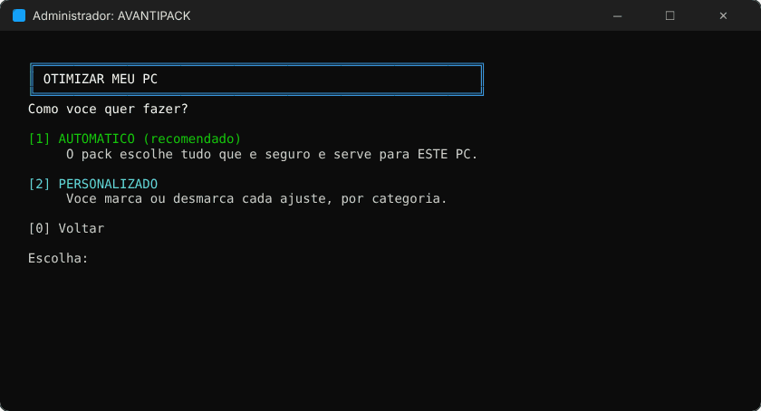
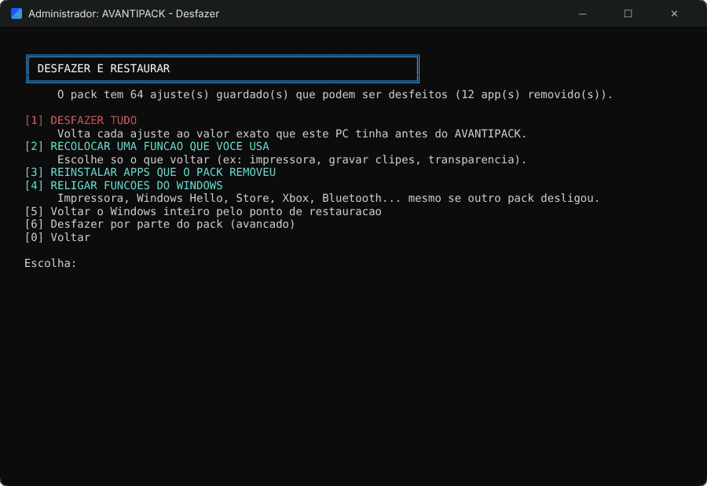
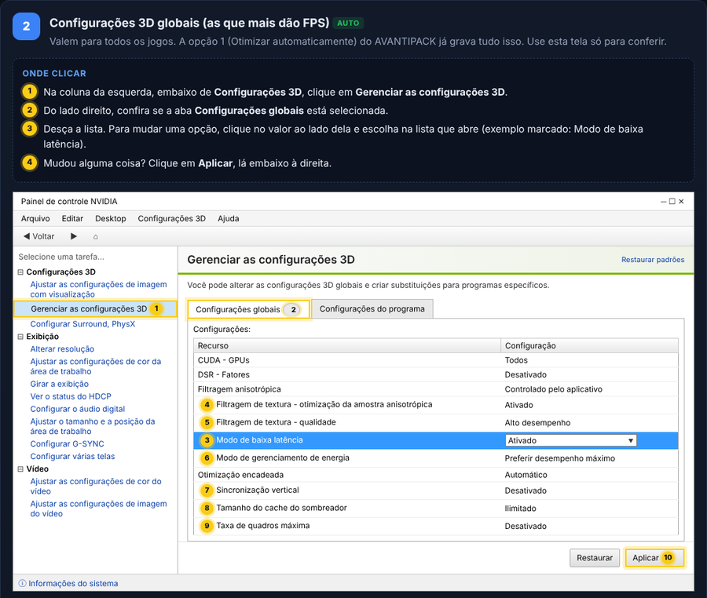
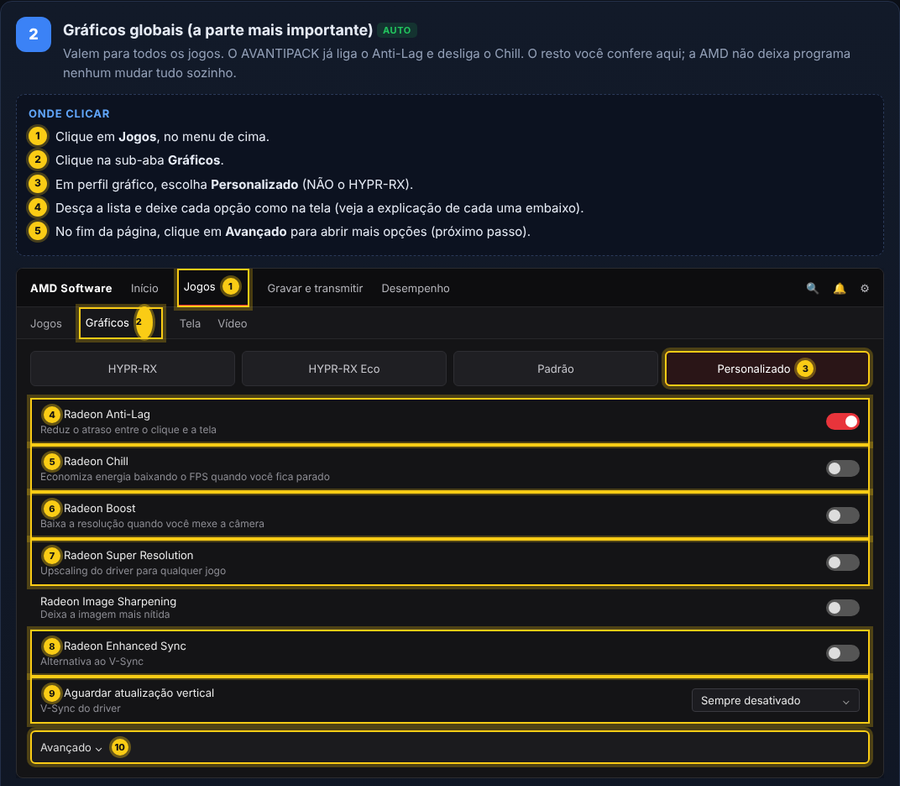

<div align="center">


<br>

<a href="../../releases/latest"></a>
<a href="../../releases"></a>


<br><br>

### 🆓 AVANTIPACK GRÁTIS

**Otimização do Windows para jogos que se adapta às peças do seu PC.**<br>
Menos input lag, FPS mais estável, Windows mais leve, e **tudo pode ser desfeito com um clique**.<br>
<sub>Quer ir além? Conheça o <a href="#-avantipack-pro">⭐ AVANTIPACK PRO</a>, com app próprio e as funções mais avançadas.</sub>

<br>

<a href="../../releases/latest"></a>
&nbsp;
<a href="#-avantipack-pro"></a>

</div>

<br>

## 🆕 Novidades

> **Versão mais nova:** [veja o que mudou](../../releases/latest) · [histórico completo](core/NOVIDADES.md)

<details open>
<summary><b>v0.8.0</b> — grátis renovado e chegada do AVANTIPACK PRO</summary>

- 💯 **Nota do PC**: de 0 a 100, com o que está segurando o seu PC e como resolver
- 🧹 **Limpeza rápida**: tira o lixo do Windows e mostra quantos MB voltaram
- 🎮 **Preparar para jogar**: fecha o que está pesando antes da partida
- 🔠 **Letra maior** já ao abrir e correções no monitor, na limpeza e no Consertar
- ⭐ Chegou o **AVANTIPACK PRO**, um app próprio com as funções avançadas ([ver abaixo](#-avantipack-pro))

</details>

<br>

## 🎬 Veja funcionando

<div align="center">

<br><sub>Modo <b>Automático</b>: o pack escolhe só o que é seguro para <i>este</i> PC e mostra cada etapa.</sub>
</div>

<br>

## ✨ Por que o AVANTIPACK é diferente

<table>
<tr>
<td width="50%" valign="top">

### 🔍 Lê o seu hardware
Detecta processador, placa de vídeo, RAM, disco e versão do Windows. Ajuste de NVIDIA não roda em placa AMD. Ajuste de SSD não roda em HD.

</td>
<td width="50%" valign="top">

### ↩️ Tudo é reversível
Cria ponto de restauração e guarda **o valor original de cada ajuste**. Desfaça tudo ou recoloque só a função que você usa.

</td>
</tr>
<tr>
<td valign="top">

### 🎯 Feito para competitivo
Foco em input lag: Reflex/Anti-Lag no driver, monitor no Hz máximo, mouse 1:1, dispositivos sem economia de energia e nota do PC.

</td>
<td valign="top">

### 🚫 Sem placebo
Nada de "+200 FPS com um regedit". Só ajustes com efeito comprovado. O que não funciona (ou faz mal) fica de fora e é [explicado por quê](guias/O_QUE_NAO_FAZEMOS.txt).

</td>
</tr>
<tr>
<td valign="top">

### 👶 Fácil para leigo
Menu em português com explicação em cada opção. Guias com telas ilustradas mostrando **onde clicar**.

</td>
<td valign="top">

### 🔄 Sempre atualizado
Avisa quando sai versão nova e atualiza sozinho. Avisa também quando um update do Windows desfez seus ajustes.

</td>
</tr>
</table>

<br>

## 🖥️ O que tem no grátis

| | Opção | O que faz |
|:-:|---|---|
| 🟢 | **Otimizar meu PC** | **Automático**: aplica só o que é seguro para o seu PC, com backup. **Reaplicar** depois de update do Windows |
| 💯 | **Verificar meu PC + Nota** | Peças, problemas (RAM sem XMP, monitor em 60 Hz, driver velho) e **nota de 0 a 100** |
| 🧹 | **Limpeza rápida** (L) | Temporários, caches e downloads velhos do Windows. Seus arquivos não são tocados |
| 🎮 | **Preparar para jogar** (J) | Mostra o que está gastando memória e fecha o que você marcar antes da partida |
| 🔧 | **Consertar um problema** | 19 reparos: sem internet, sem som, microfone, Loja, Windows Update, Alt+Tab no 24H2... |
| 📦 | **Programas úteis** | **[A] Instalar tudo automático**: programas e drivers certos para o seu PC, cada um na sua pasta |
| 📖 | **Guias** | Painéis NVIDIA/AMD/Intel ilustrados, BIOS por fabricante, limite de FPS, config dentro dos jogos |
| 🔴 | **Desfazer / recolocar** | Desfaz tudo ou só uma função, reinstala apps, religa funções do Windows |

<br>

<details>
<summary><b>📋 O que o Automático ajusta (7 categorias)</b></summary>

<br>

| Categoria | O que entra |
|---|---|
| 🛡️ **Segurança** | Ponto de restauração e backup de cada valor original |
| 🧹 **Limpeza e privacidade** | Apps inúteis, telemetria, anúncios, Widgets/Copilot/Recall, serviços e tarefas desnecessários |
| ⚡ **Sistema e input lag** | Mouse 1:1, Modo de Jogo, MMCSS, prioridade do jogo, visual leve, HPET, USB sem economia |
| 🔋 **Energia e processador** | Plano de alto desempenho conforme a CPU (AMD/Intel, desktop/notebook) |
| 🎮 **Placa de vídeo e monitor** | Painel NVIDIA automático, AMD Anti-Lag/Chill/ULPS, monitor no Hz máximo, agendamento da GPU |
| 🌐 **Internet** | Ajustes conservadores de TCP e placa de rede sem economia de energia |
| 💾 **SSD/HD e memória** | TRIM, limpeza, ajustes por tipo de disco |

</details>

<br>

## ↩️ Desfazer sem medo

Precisa da impressora de volta? Quer gravar clipes no Xbox Game Bar? Recoloque **só aquilo**, sem desfazer o resto.

<div align="center">

</div>

<br>

## 📖 Guias que mostram onde clicar

Telas ilustradas no estilo de cada painel, com números indicando o caminho e a explicação de cada opção para quem nunca mexeu.

<table>
<tr>
<td width="50%"></td>
<td width="50%"></td>
</tr>
<tr>
<td align="center"><sub><b>Painel de Controle NVIDIA</b></sub></td>
<td align="center"><sub><b>AMD Adrenalin</b></sub></td>
</tr>
</table>

Também tem: **BIOS** (XMP/EXPO, Resizable BAR... com o nome em cada fabricante), **limite de FPS**, **processador AMD/Intel** e **configurações dentro dos jogos** (CS2, Valorant, Fortnite, Warzone, LoL, Free Fire e mais).

<br>

## ⭐ AVANTIPACK PRO

<div align="center">

**Tudo do grátis, num app próprio com visual novo, e as funções mais avançadas.**

</div>

| | Grátis | ⭐ Pro |
|---|:-:|:-:|
| Otimizar automático (seguro para o seu PC) | ✅ | ✅ |
| Verificar + Nota do PC, Limpeza, Preparar para jogar | ✅ | ✅ |
| Consertar, Programas úteis, Guias, Desfazer | ✅ | ✅ |
| **Personalizado**: escolher cada ajuste, por categoria | — | ✅ |
| **Teste de FPS** antes e depois (média, 1% low, travadinhas) | — | ✅ |
| **Configurar os jogos sozinho** (CS2, Apex, Fortnite, Rocket League, Minecraft) | — | ✅ |
| **Modo Jogo automático**: energia no máximo só enquanto o jogo está aberto | — | ✅ |
| **Teste de temperatura**: descobre se o PC perde velocidade esquentando | — | ✅ |
| **Prioridade dos jogos** + **perfil NVIDIA competitivo** por jogo | — | ✅ |
| **DNS mais rápido**, **teste de input lag** com nota e **diagnóstico da internet** | — | ✅ |
| **Ajustes avançados** (VBS, MSI, hypervisor, FSO) com explicação dos riscos | — | ✅ |
| Programas da inicialização, manutenção semanal e relatório para ajuda | — | ✅ |
| App com visual próprio, sem tela de comando | — | ✅ |

> [!TIP]
> O Pro é **pagamento único**, com chave para **1 PC**. Trocou de PC? É só ativar no novo. **Em breve à venda.**

<br>

## 🚀 Como usar

```text
1. Baixe o .zip em Releases e EXTRAIA a pasta (não rode de dentro do zip)
2. Dê dois cliques em  AVANTIPACK.exe  (o ícone com a logo)
3. Escolha  [1] OTIMIZAR MEU PC  >  [1] Automático
4. Reinicie o PC no final
```

> [!TIP]
> Depois de uma atualização grande do Windows, o menu mostra uma faixa amarela. Use **Otimizar > Reaplicar** para refazer suas escolhas.

> [!NOTE]
> Se o Windows mostrar "O Windows protegeu o computador", clique em **Mais informações > Executar assim mesmo**. O pack é código aberto: dá para ler tudo neste repositório.

<br>

## 💻 Requisitos

| | |
|---|---|
| **Sistema** | Windows 10 (21H2+) ou Windows 11 |
| **Permissão** | Administrador |
| **Downloads automáticos** | winget 1.8+ (já vem no Windows 11) |

<br>

<details>
<summary><b>📁 Estrutura das pastas</b></summary>

```text
AVANTIPACK.exe     abre o pack (ícone com a logo)
LEIA-ME.txt        instruções
core\              motor do pack (menu .bat, PowerShell, versão e novidades)
guias\             BIOS, painéis ilustrados, jogos, limite de FPS
apps\              uma pasta por programa, cada uma com LEIA-ME.txt
ferramentas\       só no GitHub: launcher do .exe
docs\              só no GitHub: imagens deste README
core\dados\        criada no uso: backups e dados do seu PC (não vai pro Git)
```

</details>

<details>
<summary><b>🔄 Como funciona a atualização automática</b></summary>

<br>

O pack consulta a última **Release** deste repositório (no máximo a cada 12 h). Se houver versão maior que a do `core/VERSION.txt`, aparece a faixa verde no menu. Ao apertar **U**, ele baixa, troca os arquivos e reabre. **Backups, logs e configuração são mantidos.**

Para quem publica: [`guias/GITHUB_PASSO_A_PASSO.txt`](guias/GITHUB_PASSO_A_PASSO.txt).

</details>

<br>

## ⚠️ Aviso

Otimizações de sistema e de BIOS são **por conta e risco de quem usa**: cada PC responde de um jeito. O AVANTIPACK cria ponto de restauração e permite desfazer cada ajuste, mas recomendamos ler as explicações antes de aplicar o que está marcado como risco.

## 👤 Autor

Criado e mantido por **Pedro Henrique Margutti**, estudante de Análise e Desenvolvimento de Sistemas e Suporte de TI.

[](https://www.linkedin.com/in/pedro-henrique-margutti-158696382/)
[](https://github.com/pedromargutti)

## 📄 Licença

O código da versão grátis está sob a [licença MIT](LICENSE). Os programas de terceiros mantêm as licenças deles (veja os Créditos).

## 📜 Créditos

- [NVIDIA Profile Inspector](https://github.com/Orbmu2k/nvidiaProfileInspector) (MIT), incluído no pack
- DDU, HWiNFO, CPU-Z e os demais programas **não são redistribuídos**: o pack baixa do site oficial de cada um

<div align="center">
<br>
<sub>Feito por <b><a href="https://github.com/pedromargutti">Pedro Henrique Margutti</a></b> (Avanti) 🎮 · versão grátis para sempre · se ajudou, deixe uma ⭐</sub>
</div>
