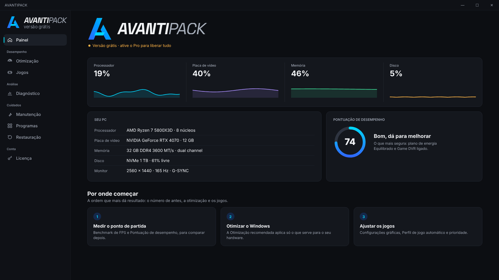
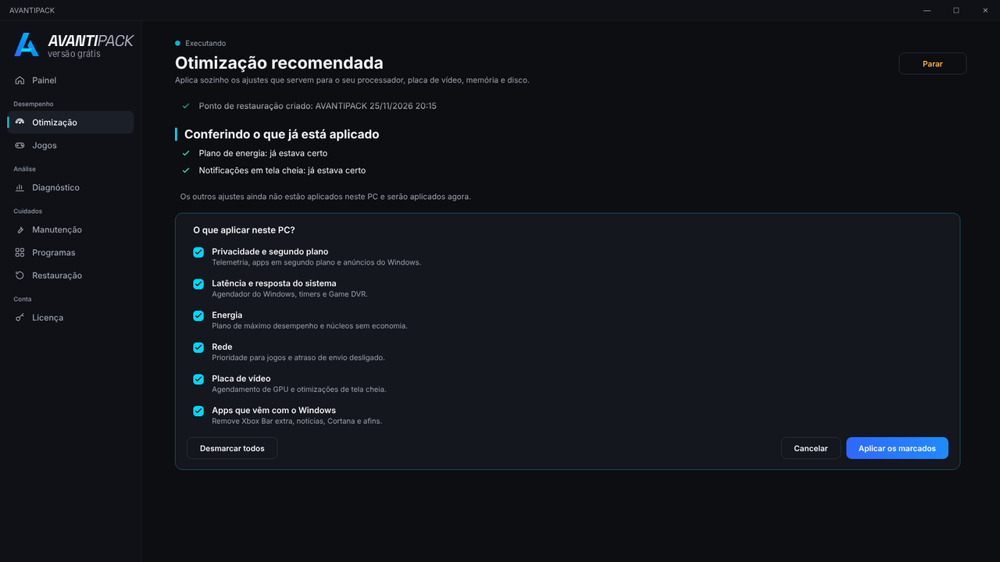
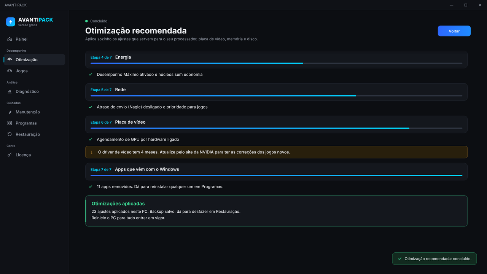

<div align="center">


<br><br>

<a href="../../releases/latest/download/AVANTIPACK-App.exe"></a>
&nbsp;&nbsp;
<a href="https://pay.kiwify.com.br/GJzVRdc"></a>

<br><br>

<a href="../../releases/latest"></a>
<a href="../../releases"></a>

<a href="LICENSE"></a>

<sub>Um arquivo só, sem instalação. As funções grátis não pedem cadastro nem chave.</sub>

</div>

<br>

## ⚡ Como funciona


<p align="center"></p>

<br>

## ✨ Por que o AVANTIPACK

<table>
<tr>
<td width="33%" valign="top">

### 🔍 Feito para o seu PC
Ajuste de NVIDIA não roda em placa AMD, ajuste de SSD não roda em HD, notebook não ganha plano de energia de desktop.

</td>
<td width="33%" valign="top">

### ↩️ Tudo reversível
Ponto de restauração e o **valor original de cada ajuste** guardado. Desfaça tudo ou só o que quiser de volta.

</td>
<td width="33%" valign="top">

### 🚫 Sem placebo
Nada de "+200 FPS com um regedit". Só ajustes com efeito real, e o manual explica o que evitamos e por quê.

</td>
</tr>
<tr>
<td valign="top">

### 🖥️ Sem tela preta
Cada função roda dentro do app: as perguntas viram botões e listas, e cada etapa mostra o que foi feito.

</td>
<td valign="top">

### 🔄 Atualiza sozinho
Avisa quando sai versão nova e troca com um clique, conferindo a assinatura do arquivo antes.

</td>
<td valign="top">

### 📖 Código aberto
O que o grátis faz está aqui, linha por linha, em PowerShell. Dá para ler tudo antes de rodar.

</td>
</tr>
</table>

<br>

<table>
<tr>
<td width="50%"></td>
<td width="50%"></td>
</tr>
<tr>
<td align="center"><sub>Você escolhe o que aplicar, sem tela de comando</sub></td>
<td align="center"><sub>Cada etapa mostra o que foi feito, com backup de tudo</sub></td>
</tr>
</table>

<div align="center"><sub>Telas ilustrativas: as peças e os números mudam conforme o seu PC.</sub></div>

<br>

## 🆓 Grátis x ⭐ Pro

| | 🆓 Grátis | ⭐ Pro |
|---|:-:|:-:|
| **Otimização recomendada** para o seu hardware, com backup | ✅ | ✅ |
| **Pontuação de desempenho** de 0 a 100 e diagnóstico do PC | ✅ | ✅ |
| **Limpeza** e **cache de shaders** (travadinhas depois de trocar o driver) | ✅ | ✅ |
| **19 reparos do Windows**: internet, som, microfone, Loja, Windows Update... | ✅ | ✅ |
| **Ferramentas e drivers** certos para o seu PC, das fontes oficiais | ✅ | ✅ |
| **Reverter ajustes**, ponto de restauração e **manual com imagens** | ✅ | ✅ |
| **Perfil de jogo automático**: energia no máximo e apps de fundo em modo eficiência só enquanto o jogo está aberto | — | ✅ |
| **Benchmark de FPS**, análise de gargalo e relatório de antes e depois | — | ✅ |
| **Raio-X da BIOS** (XMP, Resizable BAR, slot da placa) e **auditoria de input lag** | — | ✅ |
| **Configurações gráficas** gravadas no CS2, Apex, Fortnite, Rocket League e Minecraft | — | ✅ |
| **Perfis NVIDIA por jogo**, prioridade de processador e **Discord mais leve** | — | ✅ |
| **Apps que tiram FPS**: o que está pesando agora, com Fechar, Forçar e modo eficiência | — | ✅ |
| **DNS mais rápido**, latência até os servidores e teste térmico | — | ✅ |
| **Manutenção automática** todo domingo, avisando se o Windows desfez algum ajuste | — | ✅ |

<div align="center">

<br>

**Pagamento único de R$ 29,90 · chave para 1 PC · ativa dentro do próprio app**

<a href="https://pay.kiwify.com.br/GJzVRdc"></a>

</div>

<br>

## 🔑 Comprou o Pro? Ative assim

Depois do pagamento, a Kiwify abre a [página de ativação](https://pedromargutti.github.io/AVANTIPACK/obrigado/), que já baixa o app e mostra cada passo.

```text
1. Abra o AVANTIPACK-App.exe
2. Licença  >  Com o e-mail da compra
3. Digite o e-mail da compra e o código do pedido (vem no e-mail da Kiwify)
4. Ativar. Pronto: todas as funções Pro liberadas neste PC
```

Não precisa esperar chave: o pedido já libera o Pro. Se você tiver a chave, ela também funciona em **Licença > Com a chave**.

<br>

## 📖 Manual com imagens

As configurações que só dá para mudar fora do Windows, explicadas tela por tela: painel NVIDIA, AMD e Intel, BIOS por fabricante, processador, limite de FPS e configurações de 19 jogos. O manual marca os capítulos das peças do seu PC e tem busca.

<table>
<tr>
<td width="50%"></td>
<td width="50%"></td>
</tr>
</table>

<br>

## 🆕 Novidades

> [Histórico completo](core/NOVIDADES.md) · [todas as versões](../../releases)

<details open>
<summary><b>v0.11.0</b> — guias dentro do app</summary>

- 📘 Nova página **Guias** no app: painel NVIDIA/AMD/Intel, BIOS, processador, limite de FPS, 19 jogos e ferramentas, com as telas desenhadas
- 🎯 Mostra **só o que serve para as peças do seu PC** (e um botão para ver todos)
- 🧰 Os tutoriais das ferramentas saíram do Bloco de Notas e viraram guias no app
- 🖥️ App em **tela cheia** (F11 alterna) e rolagem sempre até o fim

</details>

<details>
<summary><b>v0.10.1</b> — ative o Pro com o e-mail da compra</summary>

- 🔑 Na tela **Licença**, a aba **"Com o e-mail da compra"** ativa o Pro sem esperar chave
- 🎉 A chave aparece na tela ao ativar, para você guardar
- 🔄 Primeira **atualização automática** do app: o 1.5.0 avisa e atualiza com 1 clique

</details>

<details>
<summary><b>v0.10.0</b> — chegou o app AVANTIPACK</summary>

- 🖥️ **App AVANTIPACK**: as funções grátis num app com visual próprio, sem tela de comando
- ⭐ **Pro no mesmo app**: funções Pro com cadeado, e dá para comprar e ativar a chave sem sair dele
- 🔄 **Atualização automática**, com o arquivo conferido pela assinatura
- 📦 Quem usa o pack em CMD ganha a tecla **A**, que instala o app

</details>

<br>

## ❓ Perguntas frequentes

<details>
<summary><b>É seguro? Posso voltar atrás?</b></summary>

<br>

Sim. Antes de mudar qualquer coisa o app cria um ponto de restauração do Windows e guarda o valor original de cada ajuste. Em **Restauração > Reverter ajustes** você desfaz tudo, ou só a parte que quer de volta (impressora, gravar clipes, apps removidos...).

</details>

<details>
<summary><b>O Windows mostrou "O Windows protegeu o computador"</b></summary>

<br>

É o aviso padrão para programas novos que ainda não têm muitos downloads. Clique em **Mais informações > Executar assim mesmo**. O código do grátis está todo neste repositório para quem quiser conferir.

</details>

<details>
<summary><b>Precisa de internet?</b></summary>

<br>

As funções grátis funcionam sem internet. A internet é usada para baixar programas e drivers, para ativar o Pro e para procurar atualizações.

</details>

<details>
<summary><b>Funciona em notebook?</b></summary>

<br>

Sim. O app identifica notebook e escolhe o plano de energia e os ajustes certos para ele. Placa de vídeo integrada também é reconhecida.

</details>

<details>
<summary><b>Já uso o pack em CMD. O que faço?</b></summary>

<br>

Ele continua funcionando. Atualize pela tecla **U** e aperte **A** no menu: o pack baixa e instala o app, com atalho na Área de Trabalho. Seus backups continuam valendo. Quem preferir ainda encontra o `.zip` em [Releases](../../releases/latest): extraia a pasta e abra o `AVANTIPACK.exe`.

</details>

<details>
<summary><b>Troquei de PC. E a minha chave do Pro?</b></summary>

<br>

A chave vale para 1 PC por vez. No PC antigo, vá em **Licença > Desativar neste PC** e ative no novo.

</details>

<br>

## 💻 Requisitos

| | |
|---|---|
| **Sistema** | Windows 10 (21H2 ou mais novo) ou Windows 11 |
| **Permissão** | Administrador (o app pede ao abrir) |
| **Downloads automáticos** | winget 1.8+ (já vem no Windows 11) |

<details>
<summary><b>📁 O que tem neste repositório</b></summary>

```text
core\              as funções grátis (PowerShell), versão e novidades
guias\             MANUAL.html: manual com imagens
apps\              uma pasta por programa, cada uma com LEIA-ME.txt
AVANTIPACK.exe     abre a versão clássica em CMD
ferramentas\       só no GitHub: código do AVANTIPACK.exe e do manual
docs\              só no GitHub: imagens deste README
```

O app (`AVANTIPACK-App.exe`) fica em [Releases](../../releases/latest).

</details>

<br>

## ⚠️ Aviso

Otimizações de sistema e de BIOS são **por conta e risco de quem usa**: cada PC responde de um jeito. O AVANTIPACK cria ponto de restauração e permite desfazer cada ajuste, mas leia as explicações antes de aplicar o que está marcado como "Use com cuidado".

## 👤 Autor

Criado e mantido por **Pedro Henrique Margutti**, estudante de Análise e Desenvolvimento de Sistemas e Suporte de TI.

[](https://www.linkedin.com/in/pedro-henrique-margutti-158696382/)
[](https://github.com/pedromargutti)

## 📄 Licença

O código da versão grátis está sob a [licença MIT](LICENSE). Os programas de terceiros mantêm as licenças deles (veja os Créditos).

## 📜 Créditos

- [NVIDIA Profile Inspector](https://github.com/Orbmu2k/nvidiaProfileInspector) (MIT), incluído no pack
- DDU, HWiNFO, CPU-Z e os demais programas **não são redistribuídos**: o pack baixa do site oficial de cada um

<div align="center">
<br>
<sub>Feito por <b><a href="https://github.com/pedromargutti">Pedro Henrique Margutti</a></b> (Avanti) 🎮 · versão grátis para sempre · se ajudou, deixe uma ⭐</sub>
</div>
